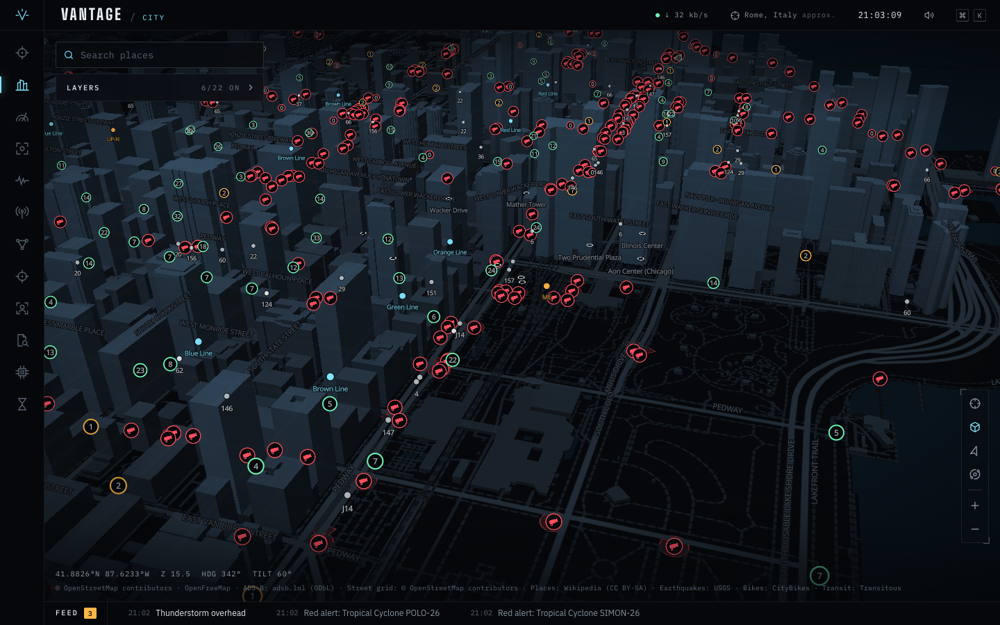
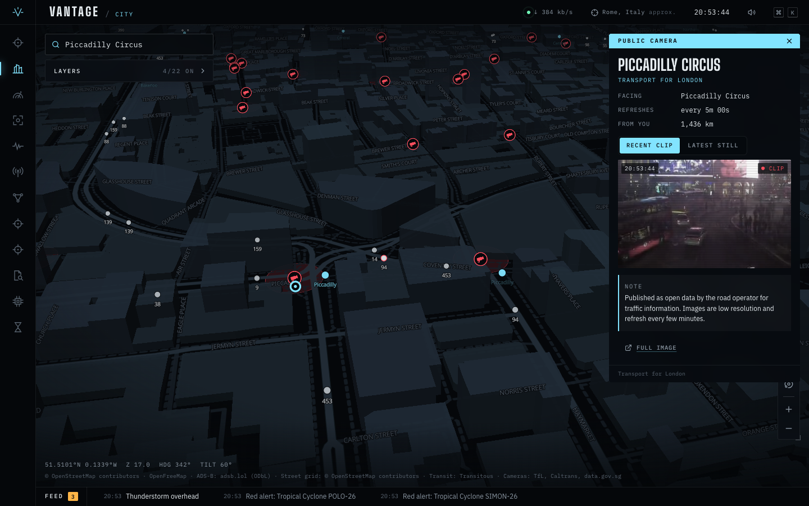
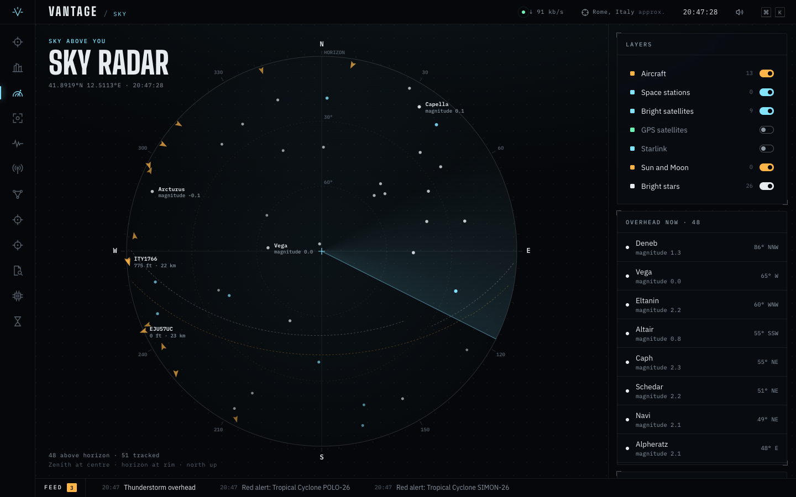
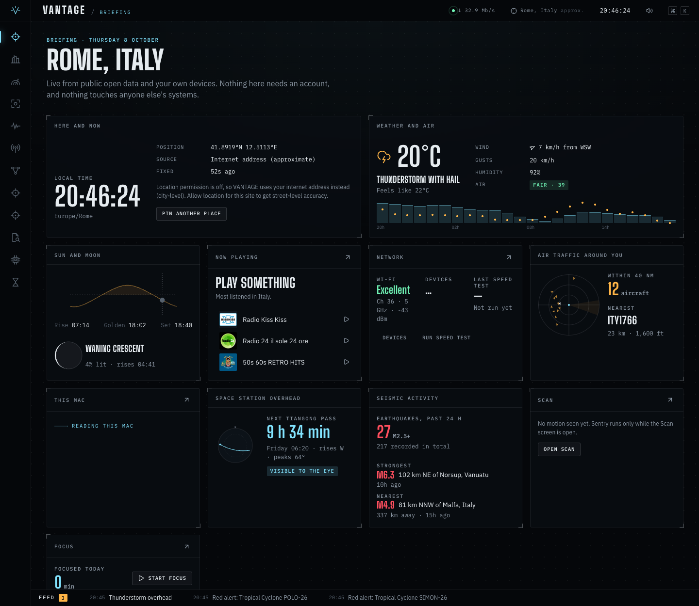
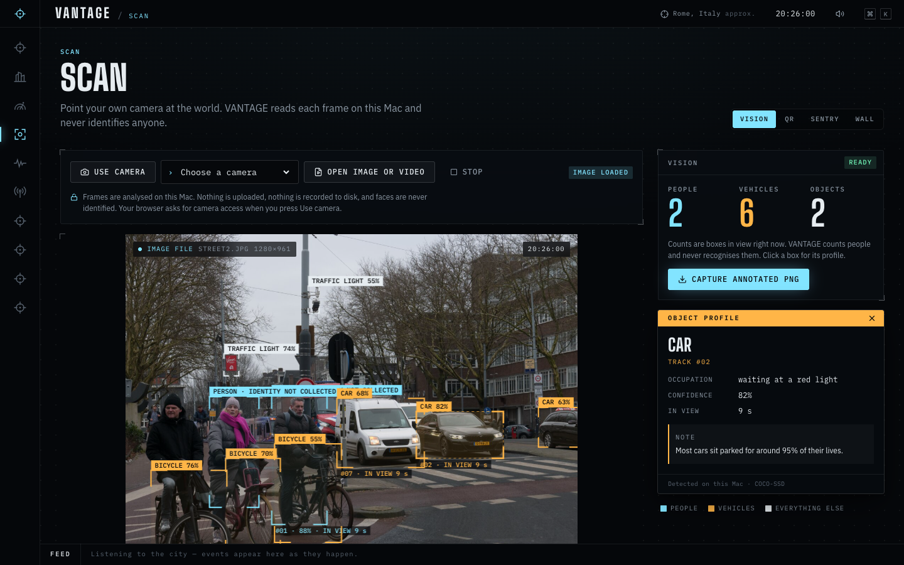

# VANTAGE

*Everything is connected.*

VANTAGE is a city operating system for your Mac, modelled on the phone Aiden Pearce carries in Watch Dogs. VANTAGE reads open data about the world around you, plus the sensors and network you own.



| | |
| --- | --- |
|  |  |
|  |  |

## Deployment mode

Server mode is the default. Host and LAN features require `VANTAGE_LOCAL=1`. For a local Mac setup, run `VANTAGE_LOCAL=1 bun run start`. For Docker Compose or a one-node Swarm with Portainer, see [the deployment guide](docs/DEPLOYMENT.md).

## Run it

You need [Bun](https://bun.sh) 1.4.0 or newer. The optional host and LAN features require macOS. Server mode also runs on Linux.

```bash
bun install
bun run start
```

Open http://127.0.0.1:4747. For development with hot reload, use `bun run dev` instead.

Allow location access when the browser asks. Without it, open the command palette and choose **Set my location to…**. With `VANTAGE_LOCAL=1`, VANTAGE can instead use the host internet address for a city-level location. Press ⌘K (or `/`) for the command palette, and the number keys to switch screens.

## Optional keys

A few features need a free API key: **Live video** (YouTube) and **Photos** (Flickr) on the City map. Without a key the feature stays in the list, fetches nothing and says "Needs a free key: see README". **Webcams from Windy.com** need one too; without it, Cameras shows the road operators and OpenStreetMap only.

Copy `.env.example` to `.env` in the project root and fill in the keys you have. Bun reads `.env` when the server starts, so restart it after a change. The keys stay on the server; the browser never receives them.

**YouTube** (`VANTAGE_YOUTUBE_KEY`)

1. In the [Google Cloud console](https://console.cloud.google.com/), create a project.
2. In *APIs & Services → Library*, enable **YouTube Data API v3**.
3. In *APIs & Services → Credentials*, choose *Create credentials → API key*.
4. Edit the key and, under *API restrictions*, restrict it to YouTube Data API v3.

YouTube allows about 100 searches a day by default. VANTAGE uses at most 90, caches each map area for 15 minutes, and says when the count resets (midnight Pacific time).

**Flickr** (`VANTAGE_FLICKR_KEY`)

1. Sign in to Flickr and open the [App Garden](https://www.flickr.com/services/apps/create/apply/).
2. Choose **Apply for a non-commercial key** and describe the app, for example "personal dashboard on my Mac".
3. Copy the key. VANTAGE does not need the secret.

**Windy.com webcams** (`VANTAGE_WINDY_WEBCAM_KEY`)

1. Sign in at [api.windy.com](https://api.windy.com/keys) and create a key for the **Webcams API**. The free tier is enough.
2. Wait a few minutes: a new key takes a moment to work.

Windy adds tens of thousands of webcams worldwide to the camera wall, the City map and Around me. VANTAGE asks for the 50 nearest cameras at a time and asks again after nine minutes at most, because free-tier picture addresses stop working after ten. Each camera links to its page on windy.com, as Windy's terms ask.

**Live STIB and TEC data** (`VANTAGE_BELGIAN_MOBILITY_KEY`)

Brussels STIB departure predictions and vehicle positions, and the GPS positions of TEC buses and trams in Wallonia, come from the Belgian Mobility open data portal. It answers without a key, under a small allowance per minute. VANTAGE then asks four times less often, and when the portal says to wait, it shows timetable times for as long as the portal asks.

1. Create a free developer account on the [Belgian Mobility open data portal](https://data.belgianmobility.io/).
2. Subscribe to the open data APIs and copy your key.

**Airframe photos from Planespotters.net** (`VANTAGE_CONTACT`)

Planespotters.net answers a server only when the request says how to reach whoever runs it. Set `VANTAGE_CONTACT` to a web address or an email address of yours. VANTAGE sends it in the User-Agent of its photo requests to Planespotters.net and nowhere else. Without it, aircraft profiles show the photo adsbdb has, when it has one.

**Traffic and EV charging** (`VANTAGE_TOMTOM_KEY`)

Create a key at [TomTom Developer](https://developer.tomtom.com/) with access to the Traffic API. Enable **Road disruptions**, **Road disruption paths**, and **Traffic flow (TomTom)** in City. TomTom adds coverage in its supported markets, including Italy and Belgium. Incident requests cover at most 10,000 km²; zoom in if the layer asks you to. Choose the flow layer's colours, roads and line style in **Settings** (`,`), or with the sliders button next to the layer.

The same key can add connector status to **EV charging** with **Search** and **EV Charging Stations Availability** access. Availability access can require a separate request to TomTom. VANTAGE asks for the nearest 20 stations in the map view and checks availability every three minutes. Profiles show available, occupied, reserved, unknown and faulty connectors by plug type and power. Stations without live status remain marked as unknown.

**Internet outages** (`VANTAGE_CLOUDFLARE_TOKEN`)

Create a [Cloudflare API token](https://developers.cloudflare.com/radar/get-started/first-request/) with **Account → Radar → Read** permission. The Internet outages screen and City layer show Radar events from the past seven days, refreshed every five minutes. Map markers use Natural Earth country reference points, not precise outage locations. The profile retains country, regional, network or platform scope, affected ASNs, cause and reported start/end times. Events without a country remain in the screen's list.

**Worldwide AIS reception** (`VANTAGE_AISSTREAM_KEY`)

Get an API key from [AIS Stream](https://aisstream.io/). The existing Ships layer then subscribes to the areas you view. Coverage depends on receiving stations and radio traffic; an empty sea does not prove there are no vessels. Finland and Norway still work without this key. Profiles add voyage details, safety text and search-and-rescue aircraft reports when broadcast. The connection closes after two minutes without demand.

**Streaming APRS** (`VANTAGE_APRS_CALLSIGN`)

Set your amateur radio callsign, then enable **APRS radio stations** in City. VANTAGE logs in to [APRS-IS](https://www.aprs-is.net/Connecting.aspx) with receive-only `pass -1` and geographic filters. It does not transmit radio packets. Positions arrive as stations report; a new view needs time to receive them. Profiles show callsigns, trails, raw packets, weather, status and telemetry when present. The stream stops when its screen or browser tab is hidden. Unsupported position encodings are not plotted; local packet timestamps and uncalibrated telemetry stay labelled as reported.

**Drone Remote ID** (`VANTAGE_DRONE_RECEIVER_URL`)

With `VANTAGE_LOCAL=1`, VANTAGE reads an [Orecchino](https://github.com/isaacbentley/orecchino-esp32) receiver at `http://orecchino.local/data/remoteid.json`. It is an ESP32-S3 board that stays on your home Wi-Fi and hears Remote ID over Wi-Fi beacons, Wi-Fi NAN, Bluetooth 4 and Bluetooth 5 long range. [`plugins/drones/orecchino/README.md`](plugins/drones/orecchino/README.md) shows how to build and flash it. For another receiver, such as [dump3411](https://github.com/ifnull/dump3411) with `--serve` on a Linux machine, set the exact feed URL, such as `http://receiver.local:8754/data/remoteid.json`. Both serve the same [schema-v1 JSON feed](https://github.com/ifnull/dump3411/blob/main/FEED.md). A normal laptop browser cannot receive these broadcasts itself. Detection range depends on radio conditions and hardware. Broadcasts with no position appear in the Drones list without a map pin; launch points are distinguished from live operator GNSS positions.

## Live road and emergency coverage without keys

Road disruptions also use London (TfL), Finland (Fintraffic), the Netherlands (NDW), Brussels Mobility, France's non-concession national roads (Bison Futé/DIR), and Austin traffic reports. Refresh rates range from one minute to one hour. Each profile shows the source, status and timestamps; planned works are distinct from active incidents. Road paths are drawn only when the source supplies their geometry.

Emergency incidents cover mainland Portugal (ANEPC), Victoria (VicEmergency), New South Wales (RFS), and Seattle Fire 911 dispatches. Portugal and Victoria refresh every two minutes, NSW every 30 minutes, and Seattle every five minutes. Seattle shows the past 48 hours of dispatch records and does not publish closure status. NSW also supplies fire outlines; some incident positions are local government area centres. Use the source link in each profile for the operator's current report.

## What it does

| Watch Dogs | VANTAGE | Data |
| --- | --- | --- |
| The Profiler scans people | The Profiler scans **things**: aircraft, trains, ships, weather balloons, satellites, buildings, traffic lights, cameras, quakes, sensors, devices on your Wi-Fi, links, photos, and you | Each source below |
| ctOS city map | **City**: a 3D night map with raised terrain, more than 50 live layers, search, walking, cycling and driving routes, and "what's here" for any point | OpenFreeMap, OpenStreetMap, Mapterhorn, OSRM |
| Point the phone and profile | **Lens**: approximate direction markers over your phone's rear camera for nearby landmarks, transit stops and cameras. Tap to open a profile; adjust alignment if the compass is offset | Phone GPS and orientation; existing landmark, transit and camera sources |
| — | **Time machine** on the City map: fade or swipe between today and the same place in a historical map or aerial photo, from the 1712 Fricx and 1777 Ferraris maps of the Low Countries to 1971 aerials, Cassini's France and swisstopo's archive | Digitaal Vlaanderen, NGI, Wallonia, IGN, swisstopo, Geoportale Nazionale, NASA GIBS |
| CCTV | **Cameras**: a live wall of the cameras nearest you, from about 12,000 traffic cameras by 15 operators (London, Finland, Iceland, Madrid, Catalonia, the Brenner motorway, California with live video, Hong Kong, Canada, New Zealand); cameras in places nobody goes (volcanoes, ocean buoys, Antarctic stations, aurora skies); and Earth and the Sun seen from spacecraft. **Scan**: your own cameras, with object detection, a QR phishing check, a motion sentry and a camera wall | Each operator's open data; USGS, NOAA, Australian Antarctic Division, NASA, NICT; on-device COCO-SSD |
| Surveillance everywhere | **Surveillance cameras layer**: every camera mapped in OpenStreetMap, with the direction it watches | OpenStreetMap |
| Traffic lights, bridges | **City pulse**: what city machinery is doing right now, where cities publish it: Hamburg's traffic lights changing colour live, Dutch bridges opening and motorway signs, free car-park spaces, bike counters and river levels. **Street grid**: where signals, power lines, towers, public Wi-Fi and movable bridges are | Hamburg, NDW, Ghent, Bologna, Zurich, Brussels Mobility, Waterinfo, Hub'Eau, ARPA Lombardia; OpenStreetMap |
| Blackouts | **Power**: the continental grid's 50 Hz heartbeat, once per second; the energy mix, prices and the greenest time to use power in Italy, Belgium and their neighbours; Belgium's live cross-border flows and its nuclear reactors; gas flowing into Italy and Belgium; live power cuts in Amsterdam | Energy-Charts, Elia, ENTSOG, Liander |
| Devices | **Control**: your Mac (volume, keep awake, sleep display, appearance, speech), your Shortcuts and through them HomeKit, Hue lights, printers, and a confirmed Blackout. Only what discovery finds on your own network | Your Mac and devices |
| — | **Reach**: tune radio receivers around the world, listen through satellite ground stations, see and report city repairs, and leave a note on the world map | KiwiSDR, Twente WebSDR, SatNOGS, Fix My Street Brussels, SeeClickFix, FixMyStreet, OpenStreetMap |
| Trains and traffic | **Transit**: buses, trams, metros and trains moving on the map, live departure boards, every Italian and Belgian train with its delay and platform, Rome bus crowding and service alerts, national GPS feeds, and Belgian rail works and level crossings. **Bike share** and free-floating scooters | Transitous, ViaggiaTreno, iRail, Roma Servizi per la Mobilità, OVapi, Renfe, Entur, Infrabel, CityBikes, GBFS |
| Planes overhead | **Aircraft** on the map, the radar and the feed, with callsigns, owners, operators, routes and airframe photos, each linked to FlightAware, the registry, SKYbrary or OpenCorporates | adsb.lol, adsb.fi, adsbdb, Planespotters.net |
| — | **Sky secrets**: aircraft squawking an emergency anywhere in the world, military aircraft, aircraft circling over you (news, police, survey), and amateur balloons that drift around the globe for months | adsb.lol, adsb.fi, adsbdb, SondeHub |
| — | **Sky**: a radar of everything above your horizon: aircraft, weather balloons, the ISS, bright satellites, GPS, Starlink, the Sun, the Moon and the brightest stars. Space weather, aurora chance, Earth's shields (cosmic rays over Rome and Dourbes, the magnetic field, which radio bands bounce off the sky), Galileo health, asteroid approaches and fireballs | CelesTrak, SondeHub, NOAA SWPC, NASA/JPL, NMDB, INTERMAGNET, GIRO, European GNSS Service Centre |
| — | **Deep space**: which of NASA's giant dishes is talking to which spacecraft right now, drawn at their real pointing angles, and a solar system of every probe with the time its signal has been travelling | NASA Deep Space Network, JPL Horizons |
| — | **Signal**: spectrogram, sound level, tuner and an ultrasonic tracking-beacon detector, using your microphone or an audio file | Your microphone and audio files |
| — | **Listen**: microphones and hydrophones streaming live around the world with a spectrogram, birds singing near you right now, and last night's meteors over Europe | Locus Sonus, Orcasound, BirdWeather, Global Meteor Network |
| — | **Posts** on the City map: plants, birds and insects that people photographed near you in the last 24 hours, Brussels street reports of the last week, and, with optional free keys, YouTube live streams and Flickr photos. Each post shows its photo with the credit and licence, its author with a link to their page, and the description and counts its source publishes | iNaturalist, Fix My Street Brussels; YouTube and Flickr with your own key |
| Networks | **Network**: Wi-Fi channel analysis, who is on your Wi-Fi, live throughput and a speed test. **Wire**: where your Mac's traffic goes, open ports, and a traceroute on the map | Your Mac; Cloudflare; GeoJS |
| Profiling a target | **Dossier**: the public record of any place you click: Italian and Flemish heritage entries, a Flemish street's gas and electricity use, the registered trees on the corner, Rome's pay-parking rates, and what your city is buying in public tenders; plus Rome's 887 *nasoni* fountains, how busy each public Wi-Fi hotspot was yesterday (totals only), and a "Did you know" tile | ArCo (Italian Ministry of Culture), Onroerend Erfgoed, Fluvius, Brussels, Ghent, Paris and Bologna open data, Roma Capitale, EU TED, OpenStreetMap |
| — | **Hazards**: earthquakes from three networks with a live seismograph from the station nearest you, NASA natural events, official weather warnings, GPS interference, and volunteer air, noise and radiation sensors. **Ships** in Nordic waters and optional AIS Stream reception elsewhere | USGS, EMSC, INGV, ORFEUS, NASA EONET, GDACS, MeteoAlarm, Italian Civil Protection, gpsjam.org, Sensor.Community, BfS, Safecast, Digitraffic, AIS Stream |
| — | **Sea**: sea level every minute at 234 European tide gauges with flags for unusual swings, Argo robots diving 2 km in the Mediterranean, and live seismographs at Etna, Stromboli and Campi Flegrei | IOC Sea Level Monitoring, Euro-Argo, INGV |
| — | **Weather**, air quality, pollen, a looping rain radar, live lightning over Europe, Alpine snow stations, and Belgium's measured cloud base and soil temperature. **Wikipedia places**, defibrillators and drinking water, with "find the nearest" commands | Open-Meteo, RainViewer, EUMETSAT, RMI, SLF, Wikipedia |

Watchers run in the background and post to the feed at the bottom of the screen: aircraft low overhead, space stations rising, weather balloons landing near you, nearby earthquakes, official weather warnings, rail disruptions, lightning and rain on the way, unusual sea-level swings, solar storms sweeping away cosmic rays, aurora chances, a jolt in the power grid, high radiation or fine dust, new devices joining your network, ultrasonic beacons, motion on your camera, low printer toner. Run "Enable desktop notifications" from the palette to receive them while VANTAGE is in the background.

## Extend it

Everything is a plugin in `plugins/`: one folder per domain, with its server API, types, map layers, radar targets, Profiler cards, tiles, commands and background watchers. Create one with:

```bash
bun run new my-plugin --screen --api --tile
```

Read [the architecture guide](docs/ARCHITECTURE.md) for the extension points and [the contributor rules](AGENTS.md). Run `bun run check` before you commit; it type-checks everything and enforces the plugin boundaries.

The `private/` tree is a second plugin root that is not part of the everyday app. It is off unless `VANTAGE_PRIVATE=1`, and it holds work that steps past what VANTAGE does by default; see `private/README.md`.
