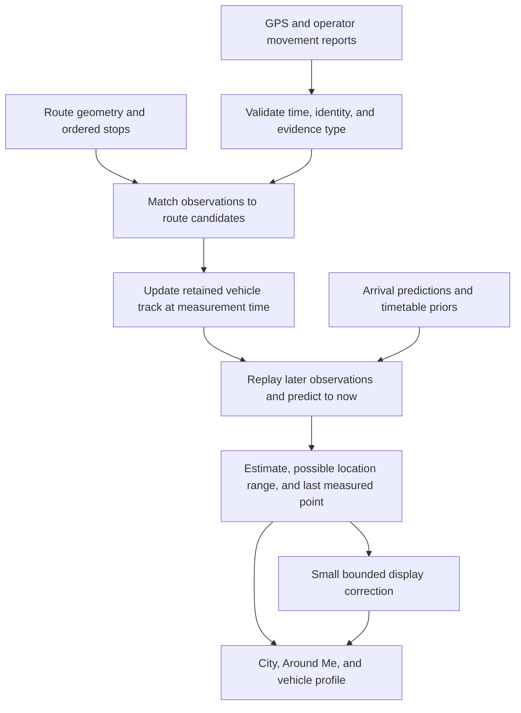

# Transit position tracking through delayed and missing GPS

Date: 2026-10-16. Status: proposed design; application code is unchanged.

Use one persistent track per physical vehicle. Correct that track at the time each observation was measured, then predict its position at the current time. Track distance along the route, speed, stop behavior, and uncertainty. Keep display animation separate from the position estimate.

The goal is the smallest practical error at the present time, with clear limits when evidence is weak. An unexpected stop, diversion, or trip change during a complete feed outage cannot be known from a timetable. The system must widen its possible location range and eventually show the last measured position. Smooth movement alone is not evidence of accuracy.

## Requirements

1. A delayed report corrects the past state, not the current marker directly.
2. Repeated, cached, or reordered reports cannot create extra movement, extra confidence, or a newer measurement time.
3. A physical vehicle keeps its identity through feed gaps, viewport changes, and trip changes. Uncertain identities stay separate.
4. Route progress follows connected geometry in the correct direction and stop order. A loop crossing does not select a new route branch by proximity alone.
5. Recent measured movement has more weight than arrival predictions and the timetable. A timetable refresh cannot move a measured vehicle.
6. Stopped vehicles, stop dwell, traffic, and terminal layovers have explicit behavior.
7. Gaps increase uncertainty. A previously measured vehicle never silently becomes a timetable-only marker.
8. A credible correction takes effect promptly. Large corrections are shown as a position update, without an invented high-speed journey.
9. City, Around Me, and the vehicle profile use the same estimate, identity, measurement age, and quality rules.
10. The algorithm is deterministic and can be tested against recorded observations with their original arrival times.

## What the current code establishes

These are code-supported failure paths. There is no recording of the reported Rome incident, so its exact cause remains unconfirmed.

| File and symbol | Current behavior | Design consequence |
| --- | --- | --- |
| `plugins/transit/fusion.ts`: `attach`, `positionAt` | Converts a fix to a timetable clock. Estimates clock speed from two fixes, defaults to 1, and caps it at 4. | Unequal leg timing and GPS noise can produce a poor speed estimate. Estimate movement in meters and seconds instead. |
| `plugins/transit/fusion.ts`: `anchor` | Scores each leg by distance and closeness to its timetable time. | Late vehicles and repeated geometry need movement history and stop order, rather than time proximity as the main selector. |
| `plugins/transit/fusion.ts`: `rememberReports` | Keeps the latest and previous fix. Emits tracks represented in the current input, rather than all still-valid remembered tracks. | A missing record can remove a measured track from the response even though its history remains in memory. |
| `plugins/transit/api.ts`: `GET /trips` | Loads Transitous before GPS; a failed Rome GPS request returns `placed`, which can contain only timetable positions for Rome. | Feed failures need explicit health and retained vehicle tracks. Independent sources should load independently. |
| `plugins/transit/VehicleLayer.tsx`: `GLIDE_MS`, `glidePosition` | Blends longitude and latitude toward each new result over four seconds. | Large corrections can cross buildings or imply impossible speed. Animation needs a small error budget and route geometry. |
| `plugins/transit/fusion.ts`: `positionAt`; `VehicleProfile.tsx` | After two minutes, prediction freezes. The profile calls this the last known position, although the point can be the end of a prediction. | Preserve and label the last measured point separately from every forecast. |
| `plugins/transit/gtfsrt.ts`: `readVehicleLabel`, `readTrip`, `readVehicle` | Combines vehicle id and label; omits trip-instance and stop-sequence metadata. | Preserve identity and movement evidence before matching. |
| `plugins/transit/stib.server.ts`: `placeVehicles` | Derives coordinates from stop distance, uses a row index in identity, and supplies receipt time as `at`. | Provider-derived positions need a different evidence type. Unknown measurement time and unstable identity must remain explicit. |

Reuse the existing plugin, provider adapters, cache helpers, map layer, profile, and motion hooks. Keep this work inside `plugins/transit/`. No new map screen or kernel tracking service is needed.

## Data flow



### 1. Preserve observations and their clocks

Each normalized observation carries its source, evidence type, original identifiers, position or route-distance measurement, optional speed and bearing, stop information, and time information. Preserve missing values as missing.

Keep three distinct timestamps: when the position was measured, when the feed was produced, and when VANTAGE received it. GTFS defines the vehicle timestamp as measurement time; its feed header has a different meaning. Vehicle id, display label, and trip-instance metadata also have distinct roles. [GTFS Realtime reference](https://gtfs.org/documentation/realtime/reference/).

Validate external fields once at the adapter boundary with the existing zod tools. Check finite coordinates and ranges, nonnegative speed, timestamp units, and optional-field presence. Reject invalid data with a reason that can be counted. Decode the extra GTFS fields without replacing the existing decoder wholesale.

Use these evidence types:

| Evidence | Treatment |
| --- | --- |
| Timestamped GPS | Position observation with provider-specific error. Speed and heading are optional supporting measurements. |
| Operator distance from an ordered stop | Route-distance observation. Preserve its coordinate conversion error and time uncertainty. |
| Confirmed stop event | Position or progress constraint at the reported event time. |
| Predicted arrival | Weak constraint on future travel time, never a GPS observation. |
| Timetable | Prior for an unobserved run and for typical segment travel time. |

Do not replace missing measurement time with receipt time or the feed timestamp. An adapter may use a documented measurement-age bound. Without such a bound, retain an undated reported position for inspection and do not use it to fit speed or claim a current precise position. Do not estimate provider clock offset from feed age: age also includes real transport delay.

On the server, anchor UTC to a monotonic elapsed-time clock. Preserve original provider UTC timestamps, but use the anchored time mapping for event times, prediction, and age. Compare host wall time with that mapping to detect clock steps. A host clock change cannot advance a vehicle or expire its track by itself. Continue existing aging by elapsed time, expose clock uncertainty, and widen the time error of new reports while reconciliation is unresolved. If the clock error cannot be bounded, withhold precise current estimates. Re-anchor only through an explicit reconciliation that remaps retained events and replays or reinitializes affected tracks; use relocalization if the resulting position changes. A monotonic browser clock alone does not solve server clock steps.

Use `source + vehicle descriptor id` for physical identity when available. Use display labels only where provider evidence establishes uniqueness and stability. Otherwise use a documented stable entity id or a trip-instance identity with explicitly limited continuity. Preserve trip id, service date, start time, and direction when supplied. A changed trip must reset route progress and motion assumptions; the physical vehicle key can remain.

For sources without stable vehicle ids, do conservative one-to-one association using recent route progress, direction, and stop sequence. If two buses remain plausible, keep the association unresolved. Array order is never identity. Replay anonymous-source associations as a bounded competing group, such as source, route, and direction, rather than updating one inferred identity while leaving its competitors unchanged. If a group exceeds its processing bound, retain unresolved reports instead of making a forced assignment. Do not combine sources into one physical track without a verified identifier crosswalk or a sufficiently unambiguous association.

### 2. Measure progress on route geometry

Represent progress as `s`, the distance in meters along an ordered path. Cache cumulative path lengths and ordered stop occurrences once per geometry revision. Stop occurrences matter because a route can call at the same stop more than once.

Keep matching geometry independent of the current viewport. Use the connected map legs already available, and fill route context for active tracks through the existing Transitous trip loader, subject to a bounded request queue and caching. MOTIS documents trip geometry separately from map-segment polylines; decode the returned precision correctly. Its current specification is a contract reference, not proof of what the deployed version returns. [MOTIS OpenAPI](https://raw.githubusercontent.com/motis-project/motis/master/openapi.yaml).

During implementation, verify geometry from the configured production API with a captured response. Until enough connected geometry is available, prediction stops at the known path boundary. Never draw a straight connector over a missing leg. Cache static shape data separately from frequently changing arrival times.

For each observation, consider nearby path projections that are reachable from the previous state at the observation time. Score lateral error, distance traveled, direction, stop order, and reported stop status. Timetable time is a weak tie-breaker. Keep up to three plausible path candidates when a loop or parallel road is ambiguous; keep stopped and moving modes within each candidate. Do not average coordinates from different branches.

This follows the sequence-based map-matching principle: measurement history and network transitions help resolve noisy or sparse points that nearest-path matching can misassign. A full road-network routing system is unnecessary when the trip path is known. [Newson and Krumm, Hidden Markov Map Matching](https://www.microsoft.com/en-us/research/publication/hidden-markov-map-matching-noise-sparseness/).

If credible measurements leave the route, maintain an off-route track. A short heading-and-speed forecast is permitted when those measurements are valid; otherwise show the reported point with its age. Repeated off-route reports can establish a diversion without a published alert. Do not drag the bus back onto the old shape. Return to route tracking only after consistent observations support the same branch.

### 3. Update a small motion model at measurement time

For a matched route candidate, retain position and speed `[s, v]`, their covariance, mode weights for stopped and moving, the last accepted observations, and route association. Use a two-state Kalman motion filter within each mode. A small set of weighted candidates handles branch ambiguity; no general particle engine or new service is required.

For a moving mode, the basic short-step model is:

```text
s_next = s + v * dt
v_next = v
P_next = F * P * transpose(F) + Q(dt)
F      = [[1, dt], [0, 1]]
Q(dt)  = q * [[dt^3 / 3, dt^2 / 2], [dt^2 / 2, dt]]
```

Here `dt` is seconds and `q` is continuous acceleration-noise intensity. The process model must give the same prediction whether an unobserved interval is evaluated once or in smaller steps. Display frame rate cannot affect estimation. A position measurement uses `H = [1, 0]`; its variance includes location error and the distance error caused by uncertain measurement time, approximately `(speed * timeError)^2`. Initialize uncertainty broadly when speed or path association is unknown. Fit the noise values with replay rather than choosing them to make motion look smooth.

Position and speed remain constrained by mode-specific physical bounds. Process noise represents unobserved acceleration and grows over the gap. Near a stop, braking and dwell transitions replace uninterrupted constant-speed travel. Stops and moving branches remain separate when both are plausible. Preserve uncertainty through these constraints rather than clipping the mean and reporting an unjustifiably small covariance.

Update mode weights from independent evidence: a reported stopped state, movement over several timestamped fixes, speed, and stop proximity. One repeated cached point is not a new observation. Two nearly identical GPS points alone do not prove a bus is stopped indefinitely. A stopped model allows an increasing probability of departure during a gap; an elapsed scheduled departure does not force it to move.

After the first few seconds, uncertain speed relaxes toward a broad segment travel-time prior. Use observed clean trips for robust segment-speed and dwell distributions when samples exist. Start with broad timetable-derived travel times and conservative mode defaults when they do not. Never force a delayed vehicle to catch up with the timetable. Feed a new arrival prediction into the travel-time prior once; do not repeatedly count that prediction or an operator estimate derived from the same GPS as independent measurements.

Keep a bounded replay window: initially 180 seconds and at most 256 boundary-valid candidate observations per track, with a checkpoint before retained events. Retain residual-quarantined and unresolved observations too: a late earlier report can change whether a later report is plausible. The effective window is the time actually retained. If the count cap shortens it, record that boundary rather than claiming 180 seconds of history. Malformed boundary rejects remain diagnostics, not filter inputs.

When an observation arrives:

1. Validate identity, time, and duplicate status before changing a track.
2. For an observation within retained history, restore the checkpoint, insert it in measurement-time order, and replay subsequent events, including route and prior changes. Re-evaluate association and residual gates for every retained candidate; previous acceptance or quarantine is an output of replay, not a fixed input.
3. Apply an observation exactly once. Exact duplicates are no-ops; conflicting payloads at the same measurement time require a defined source revision or a conflict record, not an extra filter update.
4. Predict the corrected state to the current server time. An older accepted report may improve history but cannot replace the newest measurement age.
5. Outside the replay window, retain the report for diagnostics and association only. It cannot reset current position or freshness.

Use an uncertainty-aware residual test at the measurement time to identify outliers. Distinguish an impossible observation from a prediction that became wrong during a long gap. After a long gap, run a fresh association in parallel with the old track. Two consistent observations at distinct times can establish recovery even if the old filter rejects them. An explicit, coherent trip-instance change can reset association sooner. A lone suspect jump must not poison the next update.

Example: a report measured at 12:00:00 arrives at 12:00:25. If the bus was moving at roughly 8 m/s, the measured point can be about 200 m behind its present position. Update the track at 12:00:00 and propagate 25 seconds forward. Do not pull the current marker back to that old point. If the report instead shows a stop, replay the stop evidence and revise the current estimate and its range.

### 4. Let uncertainty control prediction

Use a possible location range that includes measurement error, uncertain speed, possible stop dwell, route ambiguity, and time error. For one route branch, this is an interval along the path plus lateral error. For several branches, retain separate intervals. A precise dot is allowed only when one branch dominates and its range is small enough.

Before calibration, label this a model range. Do not call it a statistical 90% confidence interval. After held-out replay establishes coverage, the label can state the calibrated coverage and conditions.

The initial operating values below are proposals to tune with Rome recordings, not measured provider characteristics or promised accuracy:

| Rule | Initial value |
| --- | --- |
| Matched-route forecast horizon | At most 120 s from the latest accepted timed movement observation; stop earlier when uncertainty exceeds the display limit. |
| Off-route forecast horizon | At most 15 s, with valid measured speed and bearing; otherwise no extrapolation. |
| Street-level moving dot | Dominant branch weight at least 0.9 and location-range diameter at most 150 m, including lateral error. These weights remain model scores until calibrated. |
| Recovery of a withheld dot | Range below 100 m and branch weight at least 0.95 on two distinct observations; this avoids rapid show/hide changes. |
| Last measured marker | Retain for at most 300 s after its measurement; remove earlier on an explicit end/cancellation condition where applicable. |
| Timestamp slightly in the future | Tolerate up to 5 s as time uncertainty, without predicting backward or claiming age below zero. Quarantine larger future offsets. |
| Short display correction | At most 10 m of displacement error and 500 ms; current physical speed and path constraints also apply. |

The street-level limit controls the precision shown, not whether the raw observation is retained. Rail and ferry profiles need their own validated speed, stop, and spatial thresholds. Unknown modes use conservative settings and cannot inherit high-speed rail bounds.

State behavior:

| State | Map and profile behavior |
| --- | --- |
| Timed movement evidence is usable | Show the current estimate. Say, for example, “Estimated now · GPS 18 s ago.” A forecast is still an estimate when the last report is recent. |
| Several locations remain plausible | Withhold the precise moving dot. For the selected vehicle, show the separate possible route sections and the last measured point. |
| Forecast horizon or range limit is exceeded | Show a subdued marker at the actual last measured coordinate, with its age. Remove the former forecast marker. Do not freeze a predicted endpoint and call it measured. |
| No timed observation has ever existed | Keep timetable-only service positions visibly marked as scheduled estimates. Do not claim that a physical bus was observed. |
| No usable position remains | Remove the location marker. An open profile says “Position unavailable. Waiting for a vehicle report.” |

Keep service lifecycle separate from observation freshness. A missing feed record is not a confirmed arrival, cancellation, or exit. A reported cancellation or completed run ends its route forecast, but fresh physical GPS can remain visible as a vehicle whose next service is unknown. Terminal layover does not automatically start the next trip.

### 5. Correct the display without hiding position error

The estimator is authoritative. Rendering must not feed its interpolated position back into the estimator or the history.

For a small correction on the same path revision, draw along route distance with a bounded correction offset. Start from the actual displayed position. Use a short interpolation whose speed and acceleration remain plausible; a backward correction that would appear as reversed driving uses relocalization instead. Enforce the displacement limit during the whole interpolation, not only at its start. New observations update the target without restarting a four-second delay.

For a large correction, changed branch, changed geometry, or recovered identity, replace the position with a brief fade-out/fade-in of the same vehicle. The old marker ceases to be a current location immediately. A selected profile says “Position updated after a tracking gap” when applicable. Do not make the bus race across town or take seconds to catch up with a credible position.

Use current-time prediction with no intentional playback buffer. A delayed playback mode would answer a different question. Some corrections are unavoidable when new evidence proves the earlier estimate wrong; the requirement is to prevent invented travel and minimize the duration of position error.

Reuse `useAnimationFrame` for display interpolation and the existing map helpers for GeoJSON updates. Treat vehicle motion as data motion, cap map position updates initially at 10 Hz, and update React metadata only when it changes. Hidden pages stop drawing and polling as existing hooks require. On return, evaluate age at the current time, request fresh state, and skip any animation through the hidden interval. Reduced-motion mode uses direct position changes. No frame loop may advance freshness or renew evidence.

### 6. Keep track ownership outside request results

One in-process transit tracker owns state. Provider adapters submit new observations; map requests select snapshots from it. The viewport is a query, not track identity or track lifetime.

Reuse `memo` for request coalescing and provider rate limits. Ingest a provider generation once regardless of how many clients, boxes, or profiles request it. Apply each ingestion atomically without awaiting inside track mutation; concurrent requests cannot interleave partial updates. Keep each generation's receipt and measurement metadata unchanged when the cache returns it. Record attempt, success, and failure metadata inside the provider loader, before `memo` can serve a stale value after failure. Preserve that health separately from cached data, so a failed refresh can show “Vehicle reports delayed” while retained tracks remain usable. Do not change shared cache semantics to support one plugin.

Load independent timetable and vehicle sources concurrently. If Transitous fails, retain GPS-only tracks and their last valid geometry; if GPS fails, retain tracks and increase their age. Return partial data and source-specific errors instead of making one failure erase the other source.

Keep demand-driven acquisition: active City, Around Me, or vehicle-profile requests cause refreshes through the shared provider cache. Do not add a perpetual global poller. For national snapshots, ingest relevant active regions and tracked vehicles before output clipping. For bbox APIs, use a padded acquisition area and retain tracks that cross the request boundary. After all demand stops, age tracks by their timestamps; the next request does not simulate missed observations.

Start with an active-track cap of 2,000 and the replay bounds above. Evict expired and unobserved tracks first, share geometry by revision, and measure memory. Normal replay-history trimming advances the checkpoint and preserves the state and covariance that summarize older evidence. Full track eviction removes that state; reacquisition initializes uncertainty from the evidence still available. Keep compact run aliases until the run ends plus 10 minutes, with a 6-hour fallback cap, to avoid recreating a scheduled twin while its physical track is temporarily absent. New trip instances are separate. Server restart starts with uncertain state; persisting filter internals is unnecessary for the first release.

Return a transit snapshot envelope containing server time, process epoch, monotonic revision, query key, source health, and vehicle snapshots. Each vehicle includes:

- Stable identity, per-track revision, and trip association, with association quality.
- Last timed observation, its original time, and evidence source.
- Current estimate and a bounded motion description usable by the pure `positionAt` evaluator.
- Possible location ranges, path revision, quality state, and forecast expiry.
- Last measured coordinate, kept separate from projected and animated coordinates.

Keep these payload types in `types.ts`; keep filter history and covariance internal. Change all `/api/transit/trips` consumers together. In `client.ts`, order query membership by revision within the same query key and process epoch; merge shared vehicle state by its per-track revision. A newer response for one area is not a replacement for another area's response. Removing a vehicle from a query result does not delete its shared track or another query's membership.

On an unexpected process epoch, confirm the current epoch through a fresh uncached transit request before replacing client state. Retire the preceding epoch and reject its late responses. Concurrent epoch confirmations use one client generation barrier so an older pending confirmation cannot reverse a completed transition. Do not order random epoch ids or rely on wall-clock startup times. Reset revision and time mappings only after the confirmed transition.

Use server-time offset plus a monotonic browser clock to evaluate snapshots. Account for request round-trip uncertainty; a local wall-clock change must not move vehicles. Return route geometry once per revision within a response, rather than per vehicle when shared.

City, Around Me, and profile code call the same pure estimate evaluator. Source failure, absent GPS, unknown identity, and missing geometry remain distinct states with plain messages. An undated or last-known position must not receive the “live” status used by nearby vehicles.

## Validation and release gates

Record provider payloads, receipt times, source health, route geometry revisions, and forecast output for a small Rome sample. Sampling stays within existing provider limits. Store reproducible public-data fixtures under `plugins/transit/fixtures/`; do not require a live feed for deterministic tests.

Replay by receipt time. At every prediction instant, expose only observations that had arrived by then. Later GPS may score an earlier forecast, but cannot enter its inputs. Use separate days/runs for tuning and evaluation. Future provider fixes are a useful reference with their own error; they are not independent ground truth. Use an independent reference trace where available before claiming physical accuracy.

Compare with the existing algorithm, last-fix hold, and simple bounded constant-speed prediction on the same tracks. Include stationary buses, moving buses, route crossings, terminal layovers, and actual gaps. Report median and 95th-percentile position error by observation age: 0–15, 15–30, 30–60, 60–120, and over 120 seconds. Also report the fraction of vehicles and time for which a current estimate is withheld. Compare paired timestamps and error at matched availability; withheld estimates are missing estimates, never zero-error samples. Hiding difficult cases must not appear as an accuracy improvement.

Also replay known synthetic ground-truth paths with injected delay, dropped packets, stops, noise, and diversions. Include unannounced stop and departure events during outages. This tests the model against motion that its own priors did not supply. Recorded feed replay remains necessary because synthetic paths alone cannot establish Rome accuracy.

Mandatory deterministic cases:

| Case | Required result |
| --- | --- |
| Same payload requested by two clients or ten times from cache | Identical state and confidence to one ingestion. |
| Reports arrive out of order within replay history | Same final estimate as measurement-ordered ingestion of those observations and prior events. |
| A late earlier fix makes a previously quarantined later fix plausible | Replay re-evaluates both candidates and reaches the same association and estimate as ordered ingestion. |
| GPS is 25 s delayed | Correct the 25 s old state and predict forward; do not use the old fix as the present position. |
| A bus stops between reports | Stop evidence corrects the track; holdout gap tests include both continued-stop and resumed-motion outcomes in uncertainty. |
| Single 1 km GPS spike, then normal data | Spike is quarantined; the following valid point recovers without inheriting false speed. |
| Several consistent points far from the old forecast after a gap | Recover association instead of rejecting the vehicle indefinitely. |
| Figure-eight, shared stop id, parallel return route | No branch or direction switch from one nearest-point projection. |
| Missing bus row; successful empty feed; feed timeout | Retain age-limited tracks with distinct source status. No automatic timetable reset. |
| Timetable outage with healthy GPS | GPS vehicles remain visible; prior geometry remains usable within its limits. |
| Two physical buses share a trip id or display label | Two tracks when stable vehicle ids distinguish them; ambiguous data does not merge them. |
| Same physical vehicle begins a new trip after midnight | Physical identity stays; service date and progress reset correctly, including GTFS times beyond 24:00 and DST. |
| Diversion, truncated geometry, or disconnected legs | No forced snap or straight-line bridge. Apply off-route or last-known behavior. |
| Reordered source rows without stable ids | No row-index identity swap. |
| Unknown measurement time or conflicting equal-time payloads | No invented freshness or repeated confidence update. |
| Gap exceeds forecast limit | Actual last measured point is labeled last known; predicted endpoint is not relabeled. |
| Browser sleeps, client clock changes, viewport pans, or server restarts | Age and continuity rules hold without a catch-up flight. |
| Host/server wall clock steps forward or backward by 60 s | Elapsed age and motion do not jump. Clock uncertainty and any subsequent reconciliation are explicit. |
| Concurrent City query A and Around Me query B return in reverse order | Each query retains its own membership; only newer per-track state replaces shared vehicle state. |
| An old response or epoch confirmation arrives after server restart | The retired epoch cannot restore old tracks, revisions, or time mappings. |

Proposed acceptance targets, to be agreed against the captured baseline:

- Exact duplicate and replay-order invariants pass; no scripted identity swaps, route shortcuts, or stale-as-live states.
- On holdout observations aged 15–120 seconds, reduce median and 95th-percentile error by at least 20% against the current code. Fresh-data and stopped-bus 95th-percentile error must not regress by more than 5%.
- Report matched coverage beside each error result and score all cases, including withheld predictions through their stated ranges. Require no more than a 5 percentage-point drop in current-estimate availability against the baseline unless the lost availability is documented false precision. Do not broaden thresholds to conceal a failed gate.
- If a 90% range is advertised, holdout coverage should be 85–95% within each sufficiently sampled age/mode group. Report both coverage and range width. Sparse groups keep the uncalibrated label.
- Every short display correction stays within 10 m of the authoritative estimate and completes within 500 ms. Large corrections relocalize, without simulated travel.
- Benchmark 1,000 active vehicles on the development Mac: initially target under 50 ms for a provider-generation update and under 5 ms for a batch position evaluation at the 95th percentile. Track state excluding shared geometry should stay below 64 MiB. These are measurement targets, not existing results.

GTFS recommends frequent feed publication and vehicle data no older than 90 seconds. That is useful for health warnings, but does not establish how Rome behaves or guarantee a prediction horizon. [GTFS Realtime best practices](https://gtfs.org/documentation/realtime/realtime-best-practices/).

## Implementation order

Keep the work in one transit-owned change sequence. Each stage has a specific verification purpose:

1. **Observation contract and replay fixtures.** Update `types.ts`, `gtfsrt.ts`, and provider adapters to preserve identity, time, evidence type, and health. Capture the baseline. Verify optional fields, units, and cached generations.
2. **Route progress and retained tracking.** Replace timetable-clock anchoring in `fusion.ts` with ordered geometry matching, mode filters, event-time replay, and bounded history. Add focused geometry/tracking files only where they separate pure estimation from server state.
3. **API integration.** Connect `rome.server.ts`, `live.server.ts`, `api.ts`, and the existing Transitous trip loader to one tracker. Verify partial failures, concurrent requests, view changes, geometry limits, and duplicate suppression.
4. **Shared presentation.** Update `client.ts`, `VehicleLayer.tsx`, `VehicleProfile.tsx`, `nearby.ts`, and `transit.css` together. Remove `prediction.clockAtFix`, `prediction.rate`, the old two-fix history, and `GLIDE_MS` when their consumers have moved. Keep the existing map and Profiler surfaces.
5. **Replay and application checks.** Meet the invariant and accuracy gates, then run `bun run check`. Start an isolated server using the repository's `PORT` setting, verify the transit route with `curl`, and check City, Around Me, and the vehicle profile at desktop and 375 px without console errors. Use one fresh read-only review for correctness and failure recovery before publishing the implementation.

The design is ready for implementation. Accuracy targets and thresholds remain subject to recorded-feed validation. No tests, live-feed measurements, application changes, commits, or publication are claimed by this document.
